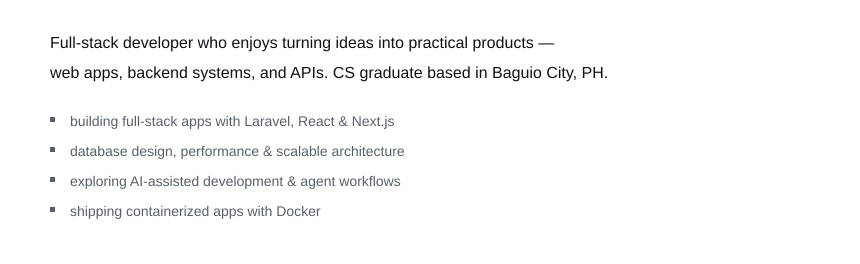
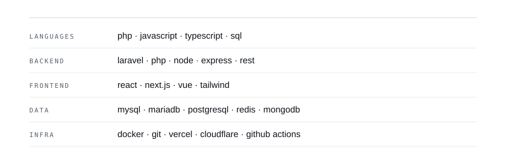
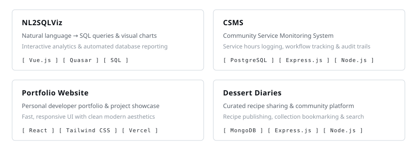
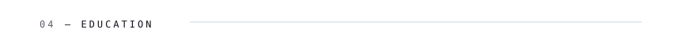
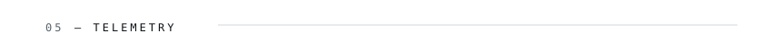
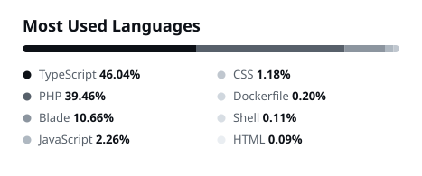
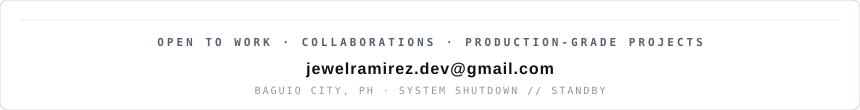

<picture>
  <source media="(prefers-color-scheme: dark)" srcset="assets/dark/header.svg"/>
  
</picture>

  

<a href="https://jewelramirez.vercel.app/"><picture><source media="(prefers-color-scheme: dark)" srcset="https://img.shields.io/badge/PORTFOLIO-0d1117?style=flat-square&logo=vercel&logoColor=ffffff"/></picture></a>
<a href="https://www.linkedin.com/in/jewel-r/"><picture><source media="(prefers-color-scheme: dark)" srcset="https://img.shields.io/badge/LINKEDIN-0d1117?style=flat-square&logo=linkedin&logoColor=ffffff"/></picture></a>
<a href="https://github.com/p1llows"><picture><source media="(prefers-color-scheme: dark)" srcset="https://img.shields.io/badge/GITHUB-0d1117?style=flat-square&logo=github&logoColor=ffffff"/></picture></a>
<a href="mailto:jewelramirez.dev@gmail.com"><picture><source media="(prefers-color-scheme: dark)" srcset="https://img.shields.io/badge/EMAIL-0d1117?style=flat-square&logo=gmail&logoColor=ffffff"/></picture></a>
<a href="https://www.facebook.com/jewell.r"><picture><source media="(prefers-color-scheme: dark)" srcset="https://img.shields.io/badge/FACEBOOK-0d1117?style=flat-square&logo=facebook&logoColor=ffffff"/></picture></a>

 

<!-- ==================== 01 WHOAMI ==================== -->
<picture>
  <source media="(prefers-color-scheme: dark)" srcset="assets/dark/s01.svg"/>
  
</picture>

<picture>
  <source media="(prefers-color-scheme: dark)" srcset="assets/dark/about.svg"/>
  
</picture>

 

<!-- ==================== 02 TECH STACK ==================== -->
<picture>
  <source media="(prefers-color-scheme: dark)" srcset="assets/dark/s02.svg"/>
  
</picture>

<picture>
  <source media="(prefers-color-scheme: dark)" srcset="assets/dark/stack.svg"/>
  
</picture>

 

<!-- ==================== 03 FEATURED PROJECTS ==================== -->
<picture>
  <source media="(prefers-color-scheme: dark)" srcset="assets/dark/s03.svg"/>
  
</picture>

<picture>
  <source media="(prefers-color-scheme: dark)" srcset="assets/dark/projects.svg"/>
  
</picture>

 

**Quick Launch &amp; Project Demos**  
[🧠 NL2SQLViz](https://jewelramirez.vercel.app/) &nbsp;·&nbsp; [🤝 CSMS](https://jewelramirez.vercel.app/) &nbsp;·&nbsp; [🌐 Portfolio Website](https://jewelramirez.vercel.app/) &nbsp;·&nbsp; [🍰 Dessert Diaries](https://dessert-diaries.vercel.app/)

 

[**Explore all production projects &amp; live demos on my portfolio →**](https://jewelramirez.vercel.app/)

 

<!-- ==================== 04 EDUCATION ==================== -->
<picture>
  <source media="(prefers-color-scheme: dark)" srcset="assets/dark/s04.svg"/>
  
</picture>

<picture>
  <source media="(prefers-color-scheme: dark)" srcset="assets/dark/education.svg"/>
  
</picture>

 

<!-- ==================== 05 TELEMETRY ==================== -->
<picture>
  <source media="(prefers-color-scheme: dark)" srcset="assets/dark/s05.svg"/>
  
</picture>

<picture>
  <source media="(prefers-color-scheme: dark)" srcset="profile/stats-dark.svg"/>
  
</picture>
<picture>
  <source media="(prefers-color-scheme: dark)" srcset="profile/top-langs-dark.svg"/>
  
</picture>

  

<picture>
  <source media="(prefers-color-scheme: dark)" srcset="https://github-readme-activity-graph.vercel.app/graph?username=p1llows&amp;bg_color=0d1117&amp;color=f0f6fc&amp;line=c9d1d9&amp;point=ffffff&amp;area=true&amp;area_color=21262d&amp;hide_border=true&amp;radius=8&amp;custom_title=CONTRIBUTION%20TELEMETRY"/>
  
</picture>

  

 

<!-- ==================== FOOTER ==================== -->
<picture>
  <source media="(prefers-color-scheme: dark)" srcset="assets/dark/footer.svg"/>
  
</picture>